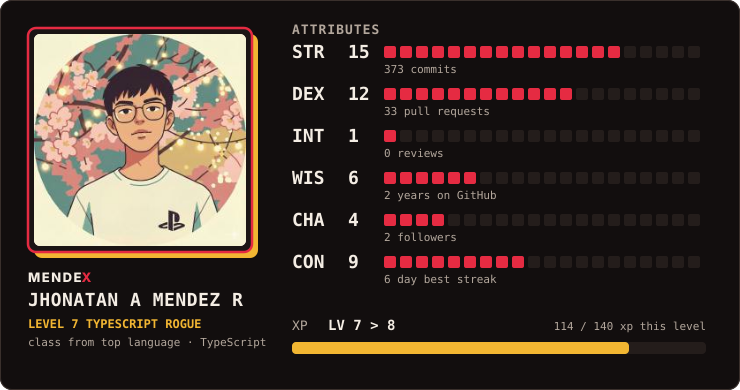
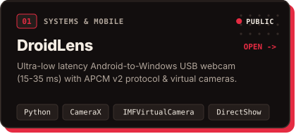
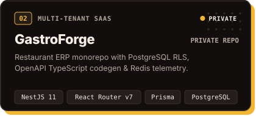
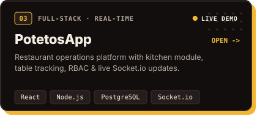
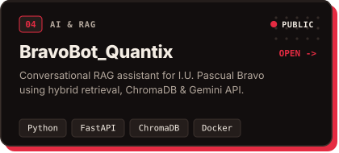
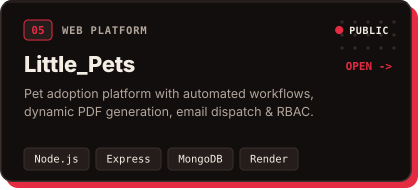
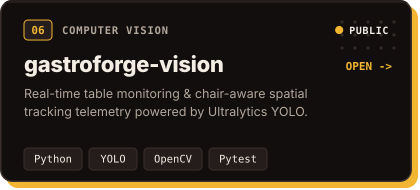
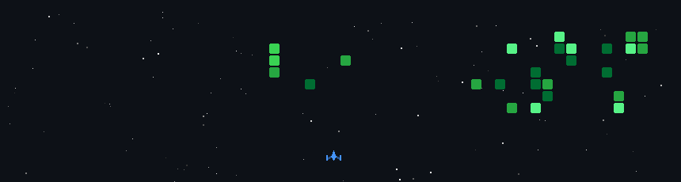

# `MENDEX` · Jhonatan Méndez

**Software Engineering Student & Full-Stack Builder · Medellín, Colombia**

  

---

## `01 // ABOUT & PRINCIPLES`

Software Engineering student at **I.U. Pascual Bravo** and Systems Technician (**SENA**), focused on building multi-tenant web platforms, real-time computer vision telemetry, and low-latency native/Android tools.

<table width="100%">
<tr>
<td width="33%" valign="top">

<strong><code>01</code> · Understand the problem.</strong>

Good software begins with understanding the people and processes behind it.

</td>
<td width="33%" valign="top">

<strong><code>02</code> · Design with purpose.</strong>

Interfaces should be intuitive, functional, and visually consistent.

</td>
<td width="33%" valign="top">

<strong><code>03</code> · Build and improve.</strong>

Continuous learning, iteration, and problem-solving drive every release.

</td>
</tr>
</table>

---

## `02 // TOOLCHAIN`

**Languages**  

**Frontend**  

**Backend & Data**  

**Vision, AI & Tooling**  

---

## `03 // FEATURED WORK`

<table width="100%">
<tr>
<td width="50%" align="center" valign="top">
  
</td>
<td width="50%" align="center" valign="top">
  
</td>
</tr>
<tr>
<td width="50%" align="center" valign="top">
  
   
  <a href="https://potetos-app.vercel.app">Live Demo →</a>
</td>
<td width="50%" align="center" valign="top">
  
</td>
</tr>
<tr>
<td width="50%" align="center" valign="top">
  
</td>
<td width="50%" align="center" valign="top">
  
</td>
</tr>
</table>

---

## `04 // EXPERIENCE & EDUCATION`

<strong>View full background</strong> (Infiny Software · Sanidad Militar · Pascual Bravo · SENA)

 

**Experience**
- **Junior Front-End Developer — Infiny Software** *(Jun 2024 – Nov 2024 · Medellín, Colombia)*
  Built React interfaces, integrated REST APIs, worked with PostgreSQL/MongoDB/Firebase, and collaborated in Agile/Scrum sprints.
- **IT Support Technician — Sanidad Militar (ESM BAJES)** *(Dec 2022 – Jan 2024)*
  Managed IT infrastructure maintenance, hardware/network diagnostics, and end-user technical support.

**Education**
- **Software Engineering** — Institución Universitaria Pascual Bravo *(Expected 2028)*
- **Technical Degree in Systems** — SENA *(2022)*

**Certifications**
- Agile Software Development *(LinkedIn Learning)* · Introduction to Cybersecurity *(Cisco)* · Web Development HTML & CSS *(Google Activate)* · C++ Programming Concepts *(SENA)*

---

## `05 // ACTIVITY & STATS`

  

  

---

## `06 // CONNECT`

 

© MENDEX · Jhonatan Méndez — Always learning, building, and shipping.

